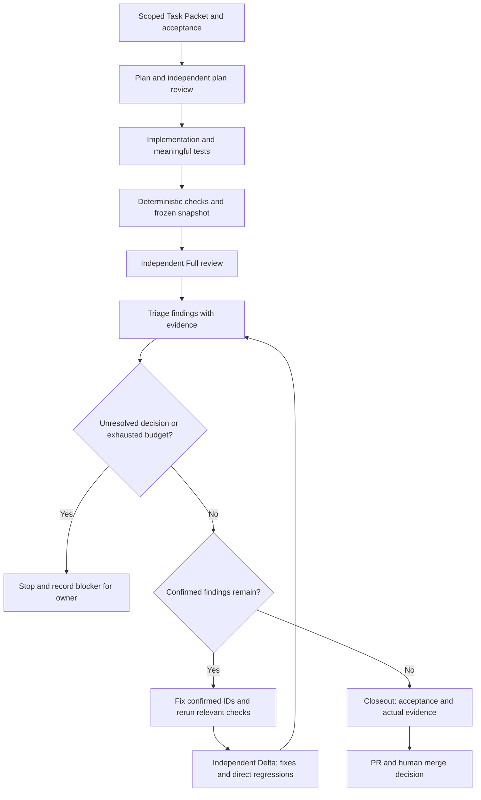
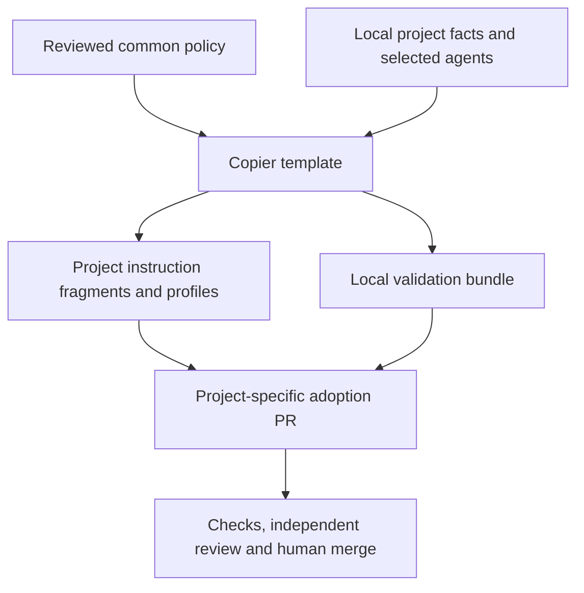

# Engineering Backbone

Versioned, reusable agent governance and engineering building blocks for software
repositories. Start with Codex and Copilot, scoped planning and verifiable checks;
add a shared capability only when real projects need it.

**Candidate 0.1.0 — not a published or downstream-approved release.**
The foundation, Codex/Copilot adapters and native identity repairs are merged.
The shared workflow kit and CI clone repair are merged. The versioned quality
framework is merged. The technology/navigation extension is an additive delivery;
adoption remains a separate project PR.

## Included in the first delivery

| Building block | Purpose |
| --- | --- |
| [Shared policy](policy/core.md) | Scope, roles, checks, Full/Triage/Fix/Delta, truthful evidence and human gates |
| [Codex and Copilot adapters](docs/agent-adapters.md) | Three Codex profiles and ten specialized Copilot profiles with explicit tool budgets |
| [Copilot operating guide](docs/copilot/workflow.md) | Eight procedural skills, permanent delivery loop, handoffs and local project integration |
| [Optional OpenCode adapter](docs/opencode/workflow.md) | Five primary roles, eight shared procedures, scoped receipts and a separate controlled-runner qualification contract |
| [Planning and evidence formats](docs/planning.md) | Task Packet, requirement status and review evidence schemas/examples |
| [Copier adoption](docs/adoption.md) | Optional providers, local project facts, preserved instructions and reviewed updates |
| [Own validation workflow](.github/workflows/quality.yml) | Schemas, adversarial tests, real consumer upgrades and trusted-base policy checks |
| [Reusable governance workflow](.github/workflows/governance-checks.yml) | Validate a copied consumer bundle without credentials for the private source repository |
| [Shared workflow kit](docs/workflows/README.md) | Strict common checks, declared language/capability profiles, scheduled maintenance and inactive release/deployment examples |
| [Quality framework](docs/quality/README.md) | Versioned sources, rules and project profiles spanning requirements, architecture, implementation, tests, review and operation |
| [Technology profiles](docs/quality/technology-profiles.md) | Common languages, shells, PostgreSQL, platforms and runtimes with mandatory rules, defaults and free choices |
| [Agent document navigation](docs/agent-navigation.md) | Explicit task/component routes and verified document context for each agent handoff |
| [Dependency compatibility policy](policy/dependencies.md) | Reviewed resolutions, supported combinations and actual compatibility evidence using the same component routes |
| [Source dependency contract](docs/dependency-compatibility.md) and [Dockerfile](Dockerfile) | Real tracked tooling inputs, dependency checks and container build/smoke |

Application language, frontend/backend presence and test commands remain project
facts. A CLI project receives no invented frontend/backend commands. Existing
stricter instructions are preserved and must be explicitly integrated with the
new fragments. Generated profiles do not activate GitHub review bots.
Provider selection is fixed during ordinary updates; a change needs a separately
reviewed migration. Safe stricter local role permissions remain valid.

## Copilot: how work proceeds

Use [the permanent operating guide](docs/copilot/workflow.md) for responsibilities,
inputs, evidence and stop conditions. Roles select who does the work; skills supply
the procedure. Each independent review starts a separate session on a frozen
snapshot. Optional handoff buttons are navigation, not an orchestrator or approval.



Required failures stop the current phase. Confirmed repairs go through triage,
checks and Delta; broader scope needs a new Full. A clean review does not replace
acceptance evidence or human merge approval. An exhausted budget records a blocker.

The package learns from pinned practical implementations in **Microsoft VS Code,
Microsoft Skills, Awesome Copilot and Spec Kit**; see
[source patterns and licenses](docs/copilot/source-provenance.md). Framework paths,
fixed models and permissive reviewer tools from those examples are not assumed.
[The client matrix](docs/copilot/clients.md) separates PyCharm, VS Code Local,
Copilot Agent Host, CLI, cloud agent and the GitHub PR bot.
[Runtime smoke tests](docs/copilot/smoke-tests.md) remain unexecuted in this environment;
structural CI and instruction simulations cannot prove Copilot discovery.

Copier always distributes the same workflow as
`.engineering-backbone/copilot-guide.md`, including when Copilot is unselected as
reference material. Native entrypoints, roles, skills and path instructions remain
protected on update and need explicit local integration. Python/frontend rules are
optional installation choices; GitHub automatic review is configured separately.

## Quality across the development lifecycle

Use [the quality guide](docs/quality/README.md) to select a versioned project
profile and map its rules to project documents, actual checks and review evidence.
The nonwaivable baseline defines responsibilities and handoffs; language and risk
profiles add requirements when applicable. The diagrams show rule ownership and
the phase gates. [The testing guide](docs/quality/testing.md) explains risk-based
coverage, agent-generated test independence and documented gaps.

Copier can seed an optional inactive `.engineering-backbone/quality-profile.json`
and four project-owned documents. Complete and review that seed before activation
in a separate PR. CI checks its structure and trusted catalog; semantic review and
actual project tests establish evidence. Public standard summaries support source
selection, not a claim of full ISO/IEC compliance or certification. C++17 and IEC
profiles remain inactive references pending project-specific adoption.

Technology profiles add scoped rules for actual project components, including
PowerShell, Bash and PostgreSQL. The project-owned navigation manifest connects
Task Packet role, task type and affected paths to required documents, versions and
real check IDs. Agents resolve and verify the complete context, then read and apply
the documents. Overlapping routes combine; exclusions and stronger policy remain
binding. Mandatory rules, justified defaults and free implementation choices are
explicitly separated. See [technology guidance](docs/quality/technology-profiles.md)
and [document navigation](docs/agent-navigation.md).

Navigation is installed inactive with the optional quality package. Review a
complete routing seed, then activate it in a separate enabled-only PR after quality
and workflows are active. Copier preserves native instructions and project routing;
update those native instructions through reviewed manual integration. Static path
and hash checks, explicit-context agent tests and native client discovery provide
different evidence. A source register or valid receipt does not prove every listed
language/runtime was tested.

The dependency extension adds an optional inactive project contract with references
to native manifests, resolutions, runtime configuration and actual Dockerfiles.
Agents receive those files and compatibility documents in the existing verified
handoff path after reviewed activation. Applications/tooling use concrete reviewed
resolutions; libraries retain justified supported ranges and reproducible test
environments. Existing project constraints leave routine package/version decisions
to the agent within scope. Copier preserves project-owned facts and documents and
does not install this repository's tooling Dockerfile into consumer applications.

## Reuse in a project



## Validate this repository

Use Python 3.12 in an isolated environment:

```sh
python -m pip install --require-hashes -r requirements.lock
python scripts/validate.py
python scripts/compile_toolchain_fingerprint.py --check
python scripts/compile_workflow_kit.py --check
python scripts/compile_navigation.py --check
python scripts/compile_quality_framework.py --check
python scripts/check_source_dependencies.py
python -m unittest discover -s tests -v
git diff --check
```

The validator checks structure and recorded evidence requirements. It does not
authenticate a human decision, prove that an installed agent loaded its profile,
or prevent an administrator from bypassing GitHub settings.

## Adopt and update

After a human-approved release, pin its actual commit and follow
[the adoption guide](docs/adoption.md). Keep native entrypoints and local facts
protected. Copier refreshes backbone-owned policy/bundles and safe fragments;
integrate changed native permissions manually in the same reviewed consumer PR.
Dependabot proposes workflow-reference/tool updates; no update is auto-merged.

## Repository readiness

Read [repository controls and observed limitations](docs/repository-controls.md)
before merge/release. Current GitHub API readback returned a tariff restriction
for private-repository rulesets and an integration restriction for branch-protection
reads. These are unresolved controls, not an enforced protection claim.

Human review, verified repository protections, live agent discovery and actual CI
evidence are distinct readiness items. This PR remains the place to review the
bootstrap before any downstream distribution.

## Codex reference consolidation

[The section and adoption map](docs/codex-consolidation.md) records portable
Codex/Copilot instructions extracted from the two source projects.
[The complete bounded file inventory](docs/source-inventory/README.md) records
paths, source commits/blobs, decisions and content-inspection coverage. Specialized
local runtime controllers and publishing signatures are preserved, not replaced.

## Further reading

- [Contribution and review process](CONTRIBUTING.md)
- [Source provenance and adaptation](docs/source-provenance.md)
- [Independent review and validation result](docs/reviews/bootstrap-result.md)
- [Technology/navigation plan](plans/technology-navigation.md) and [active Task Packet](plans/technology-navigation-task.json)
- [Quality plan](plans/quality-framework.md) and [quality Task Packet](plans/quality-framework-task.json)
- [Bootstrap plan](plans/bootstrap.md) and [original Task Packet](plans/bootstrap-task.json)
- [Security reporting](SECURITY.md)

Extend the backbone through small reviewed additions. Project architecture,
deployment, secrets, branch strategies and domain-specific controls stay local.

## Optional OpenCode adapter

Select `use_opencode=true` only during reviewed installation. Legacy absence means
false. The separate companion starts inactive; native files can still be discovered
directly. Follow the [operating guide](docs/opencode/workflow.md),
[runner contract](docs/opencode/opencode-runner-contract.md) and
[native evidence](docs/opencode/smoke-tests.md). Version 1.19.0 defaults deny
unlisted tools and require approval for implementer edits/shell, without claiming
OS isolation. Actual controlled AO admission additionally requires verified context
and explicit operator qualification; initial support is fresh ACP/chat implementer.
