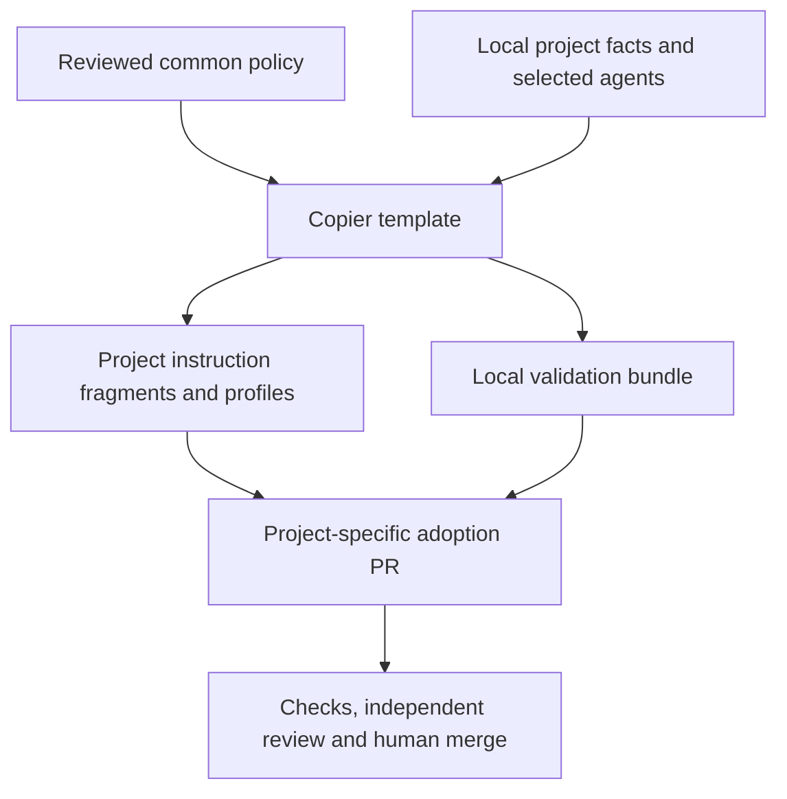

# Engineering Backbone

Versioned, reusable agent governance and engineering building blocks for software
repositories. Start with Codex and Copilot, scoped planning and verifiable checks;
add a shared capability only when real projects need it.

**Bootstrap candidate 0.1.0 — not a published or downstream-approved release.**
The initial delivery is one reviewable PR. No consumer repository is changed.

## Included in the first delivery

| Building block | Purpose |
| --- | --- |
| [Shared policy](policy/core.md) | Scope, roles, checks, Full/Triage/Fix/Delta, truthful evidence and human gates |
| [Codex and Copilot adapters](docs/agent-adapters.md) | Native planner, implementer and reviewer profiles with restricted defaults |
| [Planning and evidence formats](docs/planning.md) | Task Packet, requirement status and review evidence schemas/examples |
| [Copier adoption](docs/adoption.md) | Optional providers, local project facts, preserved instructions and reviewed updates |
| [Own validation workflow](.github/workflows/quality.yml) | Schemas, adversarial tests, real consumer upgrades and trusted-base policy checks |
| [Reusable governance workflow](.github/workflows/governance-checks.yml) | Validate a copied consumer bundle without credentials for the private source repository |

Application language, frontend/backend presence and test commands remain project
facts. A CLI project receives no invented frontend/backend commands. Existing
stricter instructions are preserved and must be explicitly integrated with the
new fragments. Generated profiles do not activate GitHub review bots.
Provider selection is fixed during ordinary updates; a change needs a separately
reviewed migration. Safe stricter local role permissions remain valid.



## Validate this repository

Use Python 3.12 in an isolated environment:

```sh
python -m pip install --require-hashes -r requirements.lock
python scripts/validate.py
python -m unittest discover -s tests -v
git diff --check
```

The validator checks structure and recorded evidence requirements. It does not
authenticate a human decision, prove that an installed agent loaded its profile,
or prevent an administrator from bypassing GitHub settings.

## Adopt and update

After a human-approved release, pin its actual commit and follow
[the adoption guide](docs/adoption.md). Keep native entrypoints and local facts
protected. Copier refreshes backbone-owned policy/bundles and safe fragments;
integrate changed native permissions manually in the same reviewed consumer PR.
Dependabot proposes workflow-reference/tool updates; no update is auto-merged.

## Repository readiness

Read [repository controls and observed limitations](docs/repository-controls.md)
before merge/release. Current GitHub API readback returned a tariff restriction
for private-repository rulesets and an integration restriction for branch-protection
reads. These are unresolved controls, not an enforced protection claim.

Human review, verified repository protections, live agent discovery and actual CI
evidence are distinct readiness items. This PR remains the place to review the
bootstrap before any downstream distribution.

## Further reading

- [Contribution and review process](CONTRIBUTING.md)
- [Source provenance and adaptation](docs/source-provenance.md)
- [Independent review and validation result](docs/reviews/bootstrap-result.md)
- [Bootstrap plan](plans/bootstrap.md) and [active Task Packet](plans/bootstrap-task.json)
- [Security reporting](SECURITY.md)

Extend the backbone through small reviewed additions. Project architecture,
deployment, secrets, branch strategies and domain-specific controls stay local.
