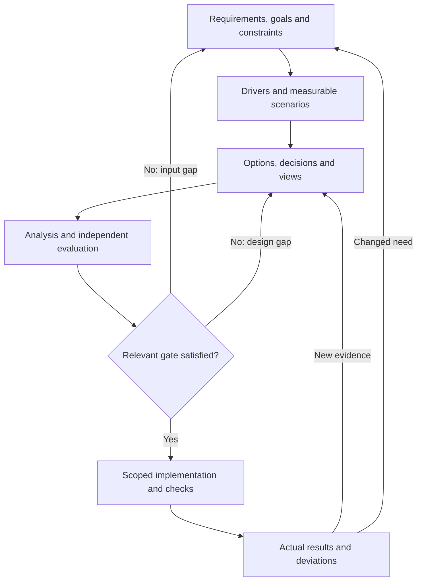
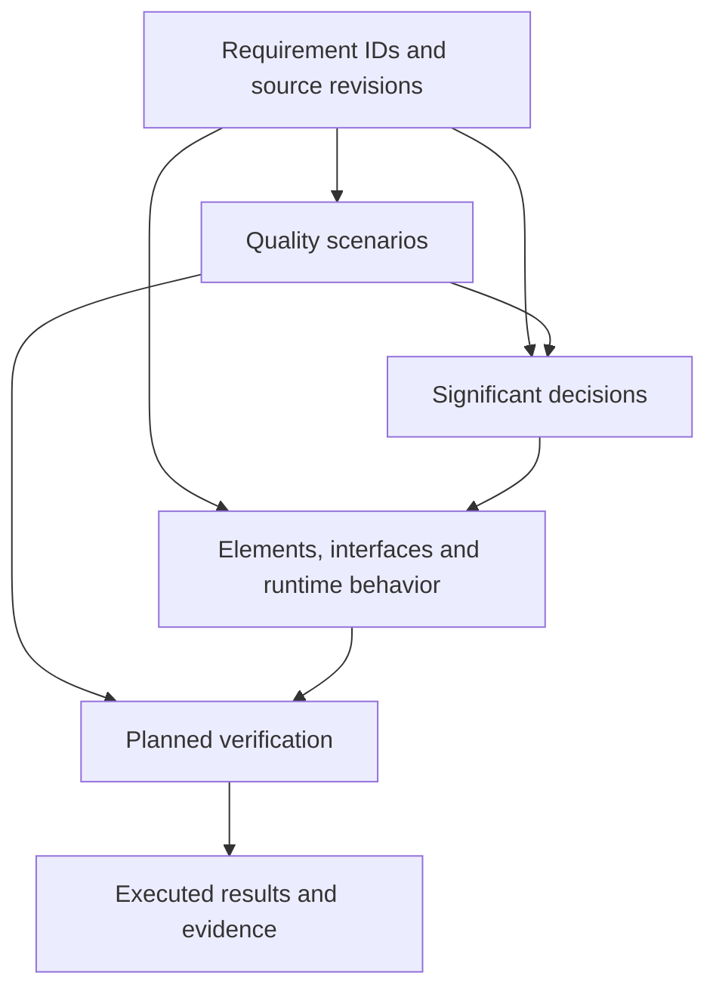

# Requirements-to-architecture contract

This is the shared semantic contract for architecture work by agents and human
reviewers. Apply it to the authorized scope of a requirements, design or material
implementation change under the [core policy](core.md). Existing stricter project
rules remain binding. A small change may use a short linked record; it must still
answer the applicable questions. A project need not redesign unrelated areas.

The contract fixes what must be explained and evidenced. Architecture style,
technology, component boundaries, notation and authoring software remain project
choices within real constraints. Its `ARCH-*` identifiers are document-local rule
references, not new entries in the quality catalog, schema fields or automated
checks. The [source record](architecture-sources.md) distinguishes our rules from
the public standards and methods that informed them. No certification or full
normative conformance is claimed.

Start with the [template index](../templates/architecture/README.md) and
[project mapping](../templates/architecture/project-mapping.md). The
[worked example](../templates/architecture/worked-example.md) illustrates the chain;
it is not an approved requirement or implemented architecture for any product.

## Obligation and design freedom

| Level | Meaning in this contract |
| --- | --- |
| MUST | Preserve authoritative inputs, justify material design, maintain traceability, expose gaps and satisfy the relevant review/evidence gate. A missing mandatory result blocks that gate. |
| SHOULD | Reuse established project conventions, compare useful alternatives, test uncertain assumptions early and prefer the smallest adequate design. Record a technical reason for a material deviation. |
| FREE | Choose suitable tools, patterns, languages, diagram detail and document grouping; propose innovative solutions and project-specific views. Routine choices within authorized scope need no new approval solely because they differ from a preference. |

Equivalent content may live in one document, several files or a project-owned
system with reviewable exports. References to existing authoritative records replace
duplication. Mark an inapplicable topic with a reason; do not use an empty heading,
placeholder or unexplained `N/A` to claim completion. Tailoring reduces irrelevant
detail, not required evidence, safety obligations or project approval rules.

## ARCH-01: Authority, scope and state

Before design decisions are treated as accepted, the project MUST record:

- The system and change boundary, stakeholders and concerns, responsible design
  owner, requirement decision authority and required independent reviewers.
- The authoritative location of requirements, constraints, architecture, decisions,
  traceability and verification evidence. Record stable IDs and a revision or
  immutable version for each reviewed source set. External sources need a stable
  locator and a version or retained reviewable snapshot where permitted.
- Which information describes a proposed target and which describes the observed
  implementation, with the corresponding source/code revisions. Both may coexist;
  label differences, migration steps and unverified claims explicitly.
- Applicable project rules, review depth, verification methods and completion gates.
  Unresolved ownership, conflicting sources and unavailable required context remain
  visible blockers for the affected decision, not authority for an agent to guess.

A document date or generated diagram alone does not identify the inspected input.
Approved requirements, accepted decisions, observed implementation and verified
behavior are separate assertions. Changing one does not automatically change the
others. The requirement owner's authority comes from the project contract; an agent
cannot confer that authority on itself.

## ARCH-02: Derive architecture from requirements

The work is iterative. Draft design and bounded experiments may help clarify an
uncertain requirement, provided their assumptions and authorized scope are explicit.
They must not silently turn a proposed target into an approved product obligation.

The planner and design author MUST carry out the following for the selected scope:

1. Identify the source, ID, approval state and acceptance criteria of each
   requirement. Clarify ambiguities, conflicts, missing acceptance thresholds and
   constraints before relying on them for an accepted decision.
2. Identify architecturally significant drivers: functionality, qualities,
   constraints or risks that materially affect boundaries, interfaces, data,
   deployment, crosscutting concepts or costly-to-change choices. Explain why they
   matter; not every requirement is a separate architecture driver.
3. Refine important quality goals into observable scenarios. Record the stimulus
   source, stimulus, environment, affected artifact, expected response and response
   measure. Include relevant usage, failure and change situations. A measure may
   be a precise qualitative condition; invented percentages and latency limits are
   not substitutes for an authorized target.
4. Explore plausible solutions, assign responsibilities and interfaces, evaluate
   risks and tradeoffs, then document significant decisions and appropriate views.
5. Define how the important design claims will be assessed before implementation
   and how the eventual behavior will be verified. Use analysis, prototype,
   inspection, automatic test, manual check or a justified combination as suitable.

An assumption MUST have an owner, its effect on the design and a resolution or
validation action. A derived requirement or proposed threshold MUST have its own
identity, derivation/source and approval state under project rules. Link it back to
the originating need or constraint. An agent may propose it; it must not mark it
approved or use it to claim accepted scope without the designated authority.
Unresolved assumptions that could invalidate a required design claim block the
dependent implementation gate unless the project explicitly authorizes a bounded
investigation that makes no completion claim.

Use the [quality-scenario template](../templates/architecture/quality-scenario.md).
Keep authoritative quality requirements in their established home; an architecture
scenario references them rather than creating a competing requirement definition.

## ARCH-03: Complete, bidirectional traceability

Every requirement in the declared scope MUST have an explicit architecture
disposition, including requirements that do not require new design:

| Disposition | Required explanation |
| --- | --- |
| Mapped target | Link the intended design elements, interfaces or behavior and relevant decisions/scenarios. This is intended coverage, not verified satisfaction. |
| Existing coverage | Identify the existing design and revision, explain its suitability and identify required confirmation or existing applicable evidence. |
| No architecture impact | Explain why the requirement does not change architecture; retain its implementation/acceptance verification obligations where applicable. |
| Open or deferred | Name the gap, owner, resolution action and affected gate. Deferral does not satisfy a requirement still included in that gate's scope. |

Scope removal or changed acceptance needs the project's authorized requirement
decision and a recorded impact assessment. Do not hide a gap by deleting a row,
renaming it as out of scope, or assigning `N/A` without a reason.

Relationships are many-to-many. One decision may serve several requirements, and
one requirement may depend on multiple views, elements and checks. Not every
requirement needs an ADR. A building block is not necessarily a source directory.

The trace record MUST let a reviewer navigate from a requirement to its design and
planned/actual verification, and back from a material design choice or check to
its purpose. Give necessary supporting infrastructure a rationale tied to a real
constraint, risk or supported responsibility instead of inventing a customer
requirement. Link material decisions to drivers and material checks to the claims
they assess. Record known gaps and source revisions so coverage can be reassessed.

Use the [traceability template](../templates/architecture/traceability.md) or an
equivalent project representation. This contract does not change the existing
requirement JSON schema or quality CSV columns/statuses. If the selected format
cannot hold ownership, derivation or richer relationships, put them in a linked
companion record keyed by stable IDs. Do not add unsupported fields or create a
second authoritative copy of the requirement. A link or nonempty evidence file
does not establish that the design or test is adequate.

## ARCH-04: The architecture description

The architecture description MUST answer the applicable questions below. These
content areas are informed by arc42; they do not require twelve files. A small
project may answer them briefly in one record. Reference existing domain/API/data
or operations documentation where it is already authoritative.

| Content area | Information to make reviewable |
| --- | --- |
| Goals and stakeholders | Purpose, relevant users/owners, their concerns, prioritized quality goals and scope. |
| Constraints | Actual technical, organizational, operating or other binding limits, with sources; distinguish constraints from preferences. |
| Context | System boundary, external parties/systems, relevant inputs/outputs and trust boundaries. |
| Solution strategy | How the main design ideas address the drivers and quality goals; important compromises. |
| Building blocks | Responsibilities, dependencies, ownership and interface contracts at useful levels. |
| Runtime behavior | Critical scenarios and relevant failures, state changes, concurrency or recovery. |
| Deployment and operation | Mapping to execution environments, external dependencies, configuration and applicable deployment/recovery assumptions. |
| Crosscutting concepts | Applicable data ownership/lifecycle, security/privacy, consistency, errors, observability and other shared mechanisms. |
| Decisions | Significant choices, rationale, consequences and links to decision records. |
| Quality | Prioritized measurable scenarios, evaluation approach and available results. |
| Risks and debt | Uncertainty, residual risk, consequences, responsible owner, action and review trigger. |
| Terminology | Domain and technical terms needed to interpret the description consistently. |

Each view MUST state its purpose, stakeholder concerns/audience, notation or
interpretation rules, represented scope and target/observed state with revision.
These properties may be declared once for a group of views when unambiguous.
Keep identities, interfaces and assumptions consistent across structural, runtime,
data and deployment views. Record discovered inconsistencies and their resolution;
an unresolved material contradiction blocks the dependent gate.

Use C4, sequence/state diagrams, text, tables or other suitable representations.
Only create levels that answer a real question. A C4 container denotes an
architectural execution/data unit; it does not mandate Docker. Neither C4 nor
LikeC4 nor a particular repository layout is required. The
[architecture template](../templates/architecture/architecture.md) provides the
content prompts without choosing a product stack.

## ARCH-05: Decisions and architectural evaluation

Record a significant decision when it affects material qualities, boundaries,
interfaces, trust, persistent data, important operating constraints or substantial
cost of change. The [decision template](../templates/architecture/decision.md)
captures the problem, drivers, relevant options, selection rationale, consequences,
risks, confirmation method, owner/status and reconsideration trigger.

Consider credible alternatives, including retaining the present design where
useful. There is no mandatory number of options and no need to manufacture weak
alternatives. Explain a genuinely constrained single choice. Evaluate how the
chosen solution meets the drivers and where it sacrifices another goal. Identify
sensitive assumptions and decisions whose consequences need early investigation.

Select evaluation depth by uncertainty and impact. A targeted scenario walkthrough
may suffice for a small change; high-risk choices may need prototypes, analysis,
security review or measured experiments. Record actual results and limitations,
including what remains to be tested on the eventual implementation. A simplified
scenario/tradeoff review is not a full ATAM evaluation.

An independent reviewer MUST assess fitness for the stated concerns and inspect
the evidence for material claims. Findings identify a concrete requirement,
constraint, risk, inconsistency or failed contract, not an aesthetic preference or
an equally valid architecture style. Innovative designs may satisfy the contract.
An accepted ADR records the decision; it does not by itself prove its benefits.

## ARCH-06: Roles and gates

Use existing Task Packet roles. A planner may analyze requirements and design
options; an implementer may author scoped design/code; a quality checker records
executed checks; independent reviewers assess the frozen scope; triage classifies
findings before repairs. Record the actual responsible people/agents and designated
requirement/decision authority. Do not invent a new schema role or require a new
human approval for every routine design choice. Existing human merge/release and
stricter project approvals always remain separate.

| Gate or claim | Minimum evidence for that scoped claim |
| --- | --- |
| Ready for design review | Sources and revisions identified; all scoped requirements have dispositions; required content, assumptions, risks and unresolved items are visible; review scope and questions are explicit. A draft may be reviewed with known gaps. |
| Ready for dependent implementation | Required input decisions are authorized; significant design choices are justified; material risks/contradictions and blockers are resolved or handled by an allowed project mechanism; verification is planned; required independent design/plan review and its triage are complete. |
| Implemented | Actual code/configuration at an identified revision is mapped to the design; relevant deviations and migration effects are assessed. A target diagram alone does not support this claim. |
| Verified | Required checks for the claim actually ran against the stated revision/environment; expected and observed outcomes, result, evidence and limitations are recorded and assessed. Required failed, missing, blocked or unexecuted evidence prevents a verified/completed claim. |

A documentation build, schema check or link check assesses structure only. It
cannot certify design fitness, implemented behavior, human approval or installed
repository protections. A prototype's evidence is limited to that prototype and
its conditions. Before completion, map acceptance to real results or explicit
pending/failed/blocked states; do not replace missing results with the plan to run
them. Verification may be automatic, manual or hybrid as selected for the claim.

Use the [review template](../templates/architecture/review.md) to record the
immutable input/design snapshot, independent identity, concerns examined, actual
methods/results, findings, coverage and limitations. Follow the core Full → triage
→ confirmed repair → Delta chain and budget. Planning review and later implementation
review have different subjects; neither substitutes for the other.

## ARCH-07: Changes and stale evidence

A change to a requirement, constraint, assumption, interface or significant
decision MUST trigger a scoped impact assessment. Follow links to affected
scenarios, decisions, views, implementation, checks and evidence. Record the old
and new references, affected claims, responsible owner and required reassessment.
Review only the affected scope and direct consequences unless the change expands
the contract or trust boundary under the core rules.

Retain superseded decisions and historical results with their original identities.
Link replacements rather than rewriting an old accepted decision to pretend it
always described the new design. Evidence from an earlier revision is not current
by default: record why it still applies or mark it stale/pending in the companion
record and arrange the required check. Do not invent unsupported schema statuses.

Better ideas discovered during implementation may change the target design. Update
the relevant decision and description, assess requirement impact and obtain the
required scoped review before presenting the new state as accepted and verified.

## ARCH-08: Tool mapping and agent handoff

The project MUST declare how its actual files or tools represent this contract:
source authority, IDs, revisions, relationships, states, required content, review
records and results. Use the [project-mapping template](../templates/architecture/project-mapping.md).
Plain Markdown, Sphinx-Needs, LikeC4 or another system may be used alone or together;
these are examples, not installed adapters or mandatory dependencies.

Generated diagrams and reports MUST retain resolvable source identity and input
version. A sidecar/index is sufficient when the output format cannot carry these
properties. The project defines which source is edited and which outputs are
derived; contradictory parallel originals are not acceptable. Tool migrations
preserve semantic IDs, relationships, status meanings and decision history, or
provide a reviewed crosswalk for changed identifiers. They must not silently drop
gaps or turn planned verification into actual evidence.

Each handoff MUST carry the Task Packet, authorized scope, source/design revisions,
applicable rule context, resolved documents, owners, pending questions, acceptance
criteria, planned checks and stop/return conditions. Resolve and read mandatory
context using active navigation where adopted; when absent, provide and read the
explicit document set. A tool receipt or agent reply does not prove that the
intended native client loaded the instructions or that the task was fulfilled.

The [planning contract](planning.md) governs the next delivery handoff: relate the
authorized design and requirement revisions to delivery outcomes, dependencies,
parallel assignments, integration and acceptance. A reviewed architecture does not
make every work item startable. Feed new design questions or contract changes back
to their decision owners and reassess affected work before proceeding.

The project mapping MUST distinguish automated structural checks from independent
semantic assessment and identify the actual project gate for each required claim.
This document introduces no semantic validator, runtime adapter, profile activation
or branch-protection change. Until separately implemented checks exist, applicable
semantic obligations are reviewed and recorded manually through the required
independent review. Projects must not describe unimplemented enforcement as active.
