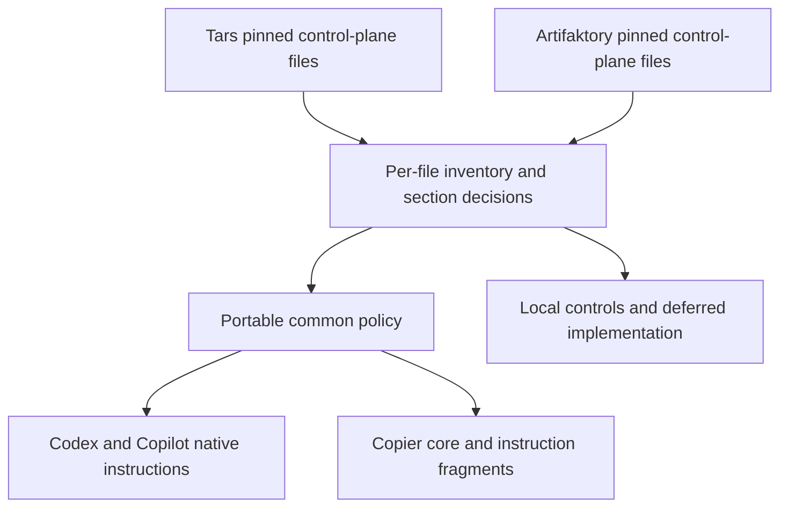

# Codex source consolidation and adoption map

This delivery inventories the Codex control-plane ecosystem of Tars and Artifaktory
and integrates its portable operating contract. The machine-readable inventories
and exact selection rules are linked from [the file inventory](source-inventory/README.md).
A path-level classification is not a semantic review of that file or a complete
implementation port. Content-inspected entries identify the extraction evidence.

## Common sections now integrated

| Shared section | Source concepts | Destination and actual behavior |
| --- | --- | --- |
| Authority and discovery | Root/path instructions, adapter authority, unexpected overrides | `policy/core.md`, root Codex/Copilot instructions and generated essential fragments |
| Planning and scope | Bounded Task Packet, plan review, required/optional reviewers and budgets | Common policy and planner/implementer/reviewer instructions; companion report holds fields outside current schema |
| Specialized responsibilities | Plan/security/traceability review, test/documentation worker, checker and triage | Existing three native profiles with task-scoped responsibilities; no extra runtime roles or schema values |
| Finding quality | Stable IDs, severity, confidence, path, trigger, execution path, impact, evidence, diff causation | Common policy and reviewer instructions; existing JSON claim/evidence or companion report carries additional detail |
| Review chain | Identical frozen snapshots, Full/Triage/Fix/Delta, prior reviewed head, coverage and limits | Common policy and native/generated reviewer instructions; the installed project runner still supplies enforcement |
| Remote review boundaries | Explicit snapshot/context, advisory status, no untriaged provider fix | Common policy and both provider instructions; automatic-review settings remain project-specific |
| Closeout and publication | Acceptance-to-evidence, pending/blocked states, residual risk and local publishing gates | Common policy and implementer instructions; existing signatures/seals/history are preserved, not replaced |

These are instructions. Existing schema and toolchain validation is unchanged and
does not authenticate plan reviews, review limits, human approval or signatures.
The same three role names and restricted tool/sandbox defaults remain in place.
No model, reasoning preset, project workflow or orchestrator is imposed.

## Controls that stay in each project

| Source area | Why it stays local | Adoption action |
| --- | --- | --- |
| Trading/risk/live-money controls | Tars domain authority and real execution permissions | Retain all rules and tests |
| Privacy/pricing/procurement/invoices | Artifaktory domain authority and business decisions | Retain all rules and tests |
| Branches, quality profiles and runner labels | Existing integration and infrastructure contracts | Supply project facts; preserve workflows and commands |
| AO ownership, skills, hook scripts and host settings | Installed runtime behavior and client capabilities | Preserve; verify actual host behavior separately |
| Publish-Go/signatures, finding seals and history anchors | Authenticated local publishing and continuity mechanisms | Continue required local gates; no backbone replacement claim |
| Detailed review-run/snapshot/remote runners and schemas | Larger control planes with different contracts | Defer an implementation port to a separately scoped, tested change |
| Requirements/architecture/issue projection machinery | Existing IDs, authority and project lifecycle | Retain; consume only the small common formats currently supplied |

## Per-project integration decisions

**Tars:** keep `feature/frontend` project facts, trading invariants, AO ownership,
local signed publish/review controls, specialized catalogs and remote context
protocol. Its policy intentionally does not run a remote review after every push.
The backbone leaves this intact: enabling automatic reviews there needs a separately
reviewed policy migration. Keep required/optional local reviewer semantics.

**Artifaktory:** keep `staging` for ordinary changes and its separate `main`
promotion, business safeguards, quality profiles, self-hosted runner operations and
local Publish-Go/Full-Delta runner. The main/staging inventory comparison records
newer development files rather than treating main as the only source.

In both projects, retain the current `AGENTS.md`, `.codex/config.toml`, native
roles, skills and Copilot files. Integrate only the approved common sections where
compatible with the stronger local text. Legacy prompts do not become authority
merely because they are inventoried. Never enable disabled features or widen a
permission while copying source material.

## Safe later adoption

This PR changes the backbone only. Once a release and repository controls are
approved, use [the adoption procedure](adoption.md) in a separate project PR:

1. Seed the pinned bundle with the correct local project facts and keep native
   instructions intact. Inspect the refreshed fragments and common core.
2. Reconcile the section table above into native files manually, preserving all
   stronger local rules, source-specific restrictions and installed publishing gates.
3. Run project checks, generation/update checks and client discovery tests. Obtain
   independent review and human merge approval.
4. Activate or update the pinned governance caller separately as documented. A
   successful Copier update is not proof of completed instruction integration.

Existing native files are protected during copy/update; new core/fragments are
refreshed. No source project is edited and no downstream update is auto-applied.

## Subsequent Copilot-specific expansion

The three-role description above records the earlier Codex consolidation. The
subsequent [Copilot package](copilot/workflow.md) supplies ten native Copilot
responsibilities and eight procedural skills, mapped onto unchanged Task Packet
schema roles. Codex keeps its existing three profiles. The original preservation
and local-control boundaries still apply; Copilot distribution and client behavior
are detailed in [its adapter guide](agent-adapters.md).
