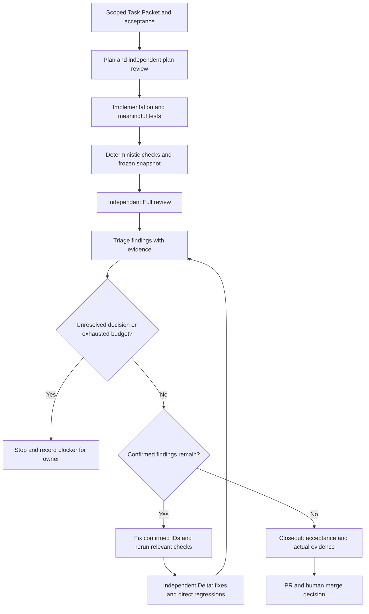

# Copilot development workflow

This is the permanent operating guide for the Copilot package. A role defines
responsibility and available tools; a skill defines a repeatable procedure. The
operator selects the next role and supplies its recorded inputs. Files and optional
handoff buttons do not implement an orchestrator, independent review or approval.

The repository's canonical policy and stricter project instructions are the
authority. In this source repository read `policy/core.md`; an adopted project
reads `.engineering-backbone/core.md` and its protected native entrypoints. Treat
proposed policy/tool changes as review material, not permission to relax the
trusted base. Local authenticated signatures, history gates and Publish-Go remain
authoritative where installed.

## The complete delivery loop

Required check failures, ambiguous authorization, scope conflicts and unsafe
changes stop the current stage immediately. A repairable confirmed defect can
proceed through authorized triage and repair; a missing owner decision or exhausted
budget stops further work. The blocker branch is never a route around an unresolved
required finding.
An expanded scope or changed trust boundary returns to planning and a new Full
review. No repairs means no artificial Delta round.

## Roles and their contracts

Managed files use lowercase `backbone-*` names in `.github/agents/` with the
canonical `.agent.md` suffix. Alternative `.md` or case spellings of those reserved
identities require reviewed manual reconciliation; they are preserved, never
automatically deleted or silently allowed to shadow the restricted profile.
Unrelated project-native role names remain valid. The packet's `role`
uses existing schema values; the selected profile records its specialization.

| Profile | Task Packet role | Responsibility and result |
| --- | --- | --- |
| `backbone-analyst` | `planner` | Clarify observable requirements, exclusions and acceptance; report unresolved inputs |
| `backbone-planner` | `planner` | Produce scoped implementation steps, risks, dependencies and verification |
| `backbone-plan-reviewer` | `reviewer` | Independently challenge feasibility, scope and missing plan checks; return plan findings |
| `backbone-implementer` | `implementer` | Implement the accepted scope and confirmed repairs; record changes and checks |
| `backbone-test-engineer` | `implementer` | Reproduce behavior and change authorized tests; production changes need explicit scope |
| `backbone-quality-checker` | `quality_checker` | Execute approved deterministic checks and report commands, exits and gaps |
| `backbone-reviewer` | `reviewer` | Independently perform Full or Delta review of a frozen change |
| `backbone-security-reviewer` | `reviewer` | Independently trace changed trust, permission and data boundaries |
| `backbone-documentation` | `implementer` | Maintain authorized docs, diagrams and acceptance/evidence traceability |
| `backbone-finding-triage` | `triage` | Confirm, reject or block each finding with rationale before implementation repairs |

Analyst, planner, plan reviewer, both code reviewers and finding triage have
`read`/`search` defaults. Implementer and test engineer also have `edit`/`execute`;
quality checker has `execute` without the direct edit tool; documentation has
`edit` without shell execution. This is a tool budget, not path isolation.
An execute-capable role can write through shell commands; the packet scope,
approved commands and runtime permissions still apply. Returned reports from
read-only profiles are persisted by an authorized writer, not by granting those
profiles edit rights.

## Skills and required inputs

Each procedure lives in `.github/skills/<name>/SKILL.md`. Start by naming the skill
and supplying its inputs; a client may also select it when its description matches.
Check actual loading in the installed client instead of assuming discovery.

| Skill | When to use | Minimum input and recorded output |
| --- | --- | --- |
| `task-intake` | Beginning or narrowing work | Authorized request and local rules → scoped packet, acceptance and blockers |
| `implementation-plan` | Before non-trivial implementation | Packet and repository evidence → plan, checks and independent review request |
| `bug-reproduction` | Investigating a specific failure | Report, environment and expected behavior → reproducer or explicit unverified gap |
| `test-and-quality` | Tests and deterministic validation | Approved commands and acceptance → real results, exit codes and coverage gaps |
| `code-review` | Independent Full review | Packet, immutable base/head and patch digest → coverage and causal actionable findings |
| `finding-triage` | Before every repair round | Findings and their evidence → confirmed/rejected/blocked IDs with reasoning |
| `delta-review` | After confirmed repairs | Prior reviewed head, repaired head and confirmed IDs → repair verdicts and direct regressions |
| `docs-traceability` | Keeping delivery understandable | Scope, requirements and actual results → maintained docs and evidence map |

## Run one task step by step

1. **Intake.** The analyst discovers root and applicable path instructions,
   confirms the request's authority and creates a packet with scope, risk,
   observable acceptance, required checks, reviewers, budget and stop conditions.
   Record the installed client, host and repository revision. Missing facts remain
   pending; application commands come from the project, not language labels.
2. **Plan.** The planner reads the relevant code and describes the smallest
   implementation, tests, dependencies and recovery. A separate plan-reviewer
   session reviews that plan read-only. Address confirmed plan defects and record
   the decision before implementation; a role switch in the author chat does not
   create reviewer independence.
3. **Implement and test.** The implementer changes only authorized paths. The test
   engineer reproduces reported failures and adds meaningful behavioral coverage
   where necessary. The documentation role updates user guidance and traceability.
   Do not introduce test frameworks, runtimes or dependencies without project need
   and authorization.
4. **Check and freeze.** The quality checker runs the approved project commands,
   records exact exits and relevant output, and marks missing/unexecuted checks
   pending or blocked. Freeze a complete commit, immutable base/head and patch
   digest for review. No required check failure proceeds as a PASS.
5. **Full review.** Start the required reviewer sessions separately from authors
   against that frozen snapshot. Review the full relevant diff, execution paths,
   tests and impact; disclose coverage gaps. Use security review when required by
   risk. Findings need concrete causation from the diff, trigger conditions,
   impact and evidence; preferences and unrelated historical defects are excluded.
6. **Triage then fix.** Finding triage records a decision and rationale for every
   ID. Only confirmed defects become repair work. Uncertain blocking claims need
   evidence or an owner decision. Check remaining budget before starting another
   repair round. The implementer repairs the confirmed IDs and reruns relevant
   deterministic checks; freeze the repaired head.
7. **Delta and repeat.** An independent reviewer receives the previous reviewed
   head, new repaired head and confirmed IDs. Inspect those repairs and directly
   introduced regressions without reopening unchanged code. Newly confirmed
   regressions return through triage and the same repair loop. Broader changes
   require a new Full; normally use at most two Full rounds unless a confirmed
   blocker, relevant new changes or a documented human exception justify another.
8. **Closeout.** Proceed only when required checks pass, acceptance has actual
   evidence, and no confirmed actionable finding remains. Record rejected findings
   and meaningful limitations; silence or missing review is not a clean verdict.
   Publish a scoped PR when authorized. The human decides merge and separately
   release/deployment; the package never grants those decisions to an agent.

## Durable handoffs

Each next session receives the packet/plan path, authority and scope, immutable
base/head, patch digest, required commands, findings/triage IDs and remaining
budget. For Delta also supply the prior reviewed head and repair range. Persist
reports through an authorized writer in project-owned locations; keep raw or
sensitive local transcripts out of committed evidence.

Example operator request to a new reviewer session:

> Use `backbone-reviewer` and `delta-review`. Read the recorded packet, previous
> Full report and triage decisions. Review confirmed IDs against the supplied
> previous and repaired heads. Report repair status and direct regressions. Do
> not edit, merge or infer a passed command from an earlier report.

New profiles offer optional handoff buttons with `send: false`. Verify the selected
role after using a button and open a separate session for independent review.
Where buttons are unsupported or context is truncated, select the next profile
manually and supply the same files. A complete report file is the handoff record;
chat history alone is insufficient evidence.

## Integration and activation boundaries

In an adopted project `.engineering-backbone/project.json` supplies local facts.
The three original planner/implementer/reviewer profiles remain backward-compatible.
Seven additional roles, eight skills and core governance/test/docs path rules form
the extended Copilot package. Preserve existing native files and stricter policy;
inspect generated fragments and manually reconcile protected files in the adoption
or update PR. The always-refreshed `copilot-guide.md` is integration guidance, not
an automatically loaded instruction file.

Python and frontend instruction examples are opt-in installation choices, both
false by default. They express technical checks without imposing a framework,
backend, directory layout or build command. Ordinary updates retain those choices;
an intentional profile migration needs a separate reviewed change. An old consumer
upgrade needs the matching reviewed reusable-workflow pin so its workflow-owned
guard can check extended assets even when the trusted base validator predates them.

This delivery sets up neither hooks, MCP servers nor automatic orchestration.
GitHub PR code review is a separate product setting: selecting `backbone-reviewer`
does not activate it. Confirm native discovery, tool calls and handoff behavior in
each intended client before asserting runtime readiness. Structural CI and a
simulation with these instructions do not prove actual Copilot execution.
