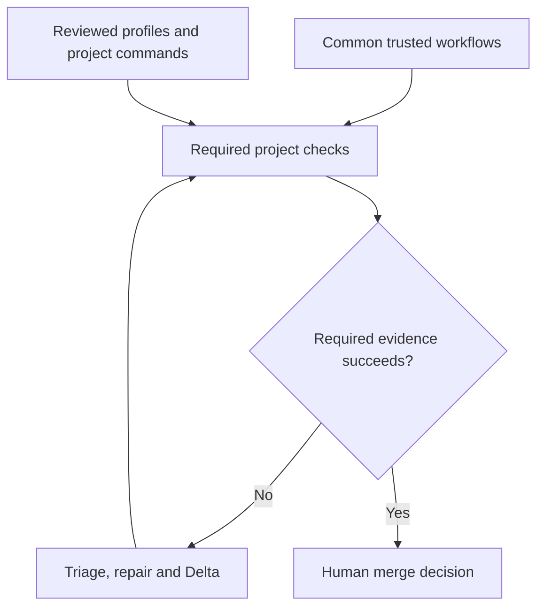

# Shared workflow kit

The kit supplies common checks and reviewed templates for mixed-language projects.
Its controls are our engineering decision, informed by practical implementations;
they are not a claim that a standard mandates identical YAML files for every repo.
Application commands, supported platforms and operational permissions stay local.

## What runs, how and when

| Workflow | Required after kit activation | How |
| --- | --- | --- |
| PR checks | Every PR and configured target-branch push | Governance, configuration, quality, project security and tracked-file secret prevention; a strict final aggregate |
| Maintenance | Scheduled and manual | Approved default-branch configuration; dependency/container checks when selected, plus tracked-file secret prevention |
| Release example | For projects producing releases | Reviewed local activation, version/integrity/provenance/signature checks; SBOM where component-bearing artifacts apply |
| Deployment example | For projects deploying services | Reviewed local environment permissions, prerequisites, smoke/recovery/monitoring checks and an explicit human decision |

The PR workflow has fixed jobs and a fixed expected aggregate. Failure,
cancellation, missing results or a skipped required job is not success. Where the
trusted catalog requires no project security command, that job reports explicit
non-applicability and still runs; core secret prevention remains separate.
Missing/inactive configuration cannot activate a full kit green result.

## Profiles and project facts

`workflows.json` is separate from the existing closed `project.json` version 1.
See the [profile catalog](profiles.json) and the shipped workflows schema. The
catalog explains required kinds; the compiled guard enforces them. Merely setting
the old descriptive language/frontend/backend fields does not execute commands.

| Selection | Required check kinds |
| --- | --- |
| Documentation | Documentation/structure checks |
| Python, Go, .NET | Build/syntax, lint, tests and static security analysis |
| TypeScript | The same, plus type checking |
| Dependencies | Dependency checks in PR and maintenance, including configured vulnerability/license policy |
| Web, API, database | Browser, API or migration checks respectively |
| Container | Container checks in PR and maintenance |
| Infrastructure | Infrastructure/configuration checks |
| Release | Integrity, provenance and signature verification; SBOM for dependency/container selections |
| Deployment | Smoke, recovery and monitoring verification |

Select every applicable profile/capability from actual repository evidence.
For mixed-language projects, configure each component's checks under stable IDs.
The validator checks the declared contract; it cannot discover every undeclared
component or establish what an arbitrary command semantically verifies. Adoption
review must compare the profile list and commands against the real project.
Absence of a suitable scanner is a visible adoption blocker, not a fake clean scan.

Each check declares an `argv` array, a repository-relative `cwd`, a bounded
`timeout_seconds`, a kind and its phases. The runner starts argument arrays
without an implicit shell; any explicitly selected executable remains project code. For an
existing approved ID on PR/push, the trusted base's command definition is executed
against candidate code; candidate additions run additionally. A proposed command
replacement needs semantic review and becomes authoritative after merge. Do not
use a harmless substitute merely to satisfy a required kind.

Declare supported runtime versions explicitly. The kit supports the declared
Python, Node, Go and .NET runtimes; an OS/version support matrix or specialised
runner requires a separately reviewed project extension. Coverage thresholds,
performance budgets, database fixtures and domain-specific acceptance stay local.
The common runner does not invent tests or impose another project's coverage rate.

### Dependency compatibility checks

When the project adopts `.engineering-backbone/dependencies.json`, its component
bindings add required PR kinds `dependency`, `build` and `test`, plus `container`
for declared Dockerfiles. Use the existing kinds and check IDs; no second workflow
runner is introduced. Existing capability obligations, including dependency and
container maintenance checks when selected, remain binding.

The `dependency` commands must establish clean installation, manifest/resolution
consistency and declared-requirement compatibility for the actual ecosystem.
Vulnerability/license scans complement these duties. The build, test and container
commands establish the recorded behavioral coverage on supported environments;
a matching kind alone does not. Existing IDs resolve to trusted-base approved
definitions during PR preparation and navigation, so changing a candidate command
does not silently replace its approved evidence contract. Review command semantics
and results, and use matching reviewed guard/workflow pins for adoption. Read
`docs/quality/dependencies.md` in the source or `.engineering-backbone/dependency-policy.md`
when installed, and follow the navigation guide for file routing and activation.

## Trust and execution

The workflow compiles its standard-library guard/runner from reviewed source into
the pinned workflow. Configuration/secret jobs do not import candidate modules or
execute application commands. Execution jobs obtain the prepared configuration and
trusted runner from their configuration job, then execute candidate project checks
in separate clean hosted jobs with read-only repository permissions, no inherited
secrets and no persisted checkout credentials. Report files do not determine the
aggregate's expected jobs or replace GitHub job conclusions.

Project code and check commands are executable code. Argument arrays and schema
validation do not sandbox malicious code. Keep them away from production networks,
deployment credentials and persistent self-hosted hosts. Permission, CI and agent
configuration changes remain HIGH risk and require independent security review.
The kit is not an enforcement claim for arbitrary local execution outside this CI.

The built-in tracked-file secret check detects its documented private-key and
provider-token patterns. It does not detect every credential, inspect all Git
history or scan remote issue comments. Adopt push prevention and an appropriate
history/provider scanner where available; leaked credentials must be revoked.
Scanner/tool/read failures are failures. Logs must not include matched secret values.

## First adoption and updates

1. Select `use_workflow_kit` when preparing a reviewed template adoption. Blank
   `workflow_kit_ref` keeps callers absent. Generated config is inactive and has
   no application commands; fill it with the complete real profile/runtime/check
   contract in the seed PR. Run local validation and project checks.
2. Merge that reviewed complete inactive seed through the existing project gates.
   Legacy projects without this config continue to use their existing governance.
3. In a separate activation PR, set `enabled` to true without mixing seed command
   changes, and add callers pinned to the reviewed Backbone commit. Reconcile
   the saved installation choices only through the documented reviewed migration.
   Configured active checks require the already approved complete seed. Adding a
   manually maintained caller does not require changing the saved blank template
   pin; retain that choice on normal Copier updates. A manually adopted kit in a
   legacy consumer likewise may retain its saved false choice and maintain its
   local contract explicitly.
4. Verify real check names, failed/green negative pilot and hosting rules. Require
   the actual final status; missing required jobs and workflows must block merge.
   Enable scheduled maintenance and assign responsibility for failed runs.
5. Update centrally versioned components through separate consumer PRs. Existing
   configuration, native callers and stronger local policy remain protected;
   review and manually integrate their needed changes and workflow pins.

Selecting a pin during first copy does not approve activation; an incomplete or
inactive seed fails closed if such a caller is run. Existing enabled configuration,
profiles/capabilities and required IDs cannot silently disappear against the base.
Migration that intentionally changes those contracts needs separately reviewed
transition work; do not edit saved answers or silently weaken required checks.

Release/deployment examples are intentionally inert. Their activation guards fail
until the project integrates real publishing/deployment steps, minimum permissions,
protected environments, verified artifacts, safe rollback and monitoring. Copying
an example is not permission to publish or deploy. CI secret-bearing/live tests
remain separate from unprivileged PR checks. No automatic downstream apply.

## Reviews and hosting controls

Keep the existing independent plan/Full/triage/fix/Delta chain. A structural result
does not authenticate reviewers, establish semantic acceptance or prove a human
decision. AI reviews are advisory unless a separately approved project contract
changes that relationship. Human merge/release decisions remain required.

Repository protections, eligible reviewers, stale-approval behaviour, exact status
names and bypass permissions must be configured and checked separately. Hosted
feature availability and rules readback may be restricted. This delivery does not
change those settings or certify their enforcement. Merge queue integration needs
a reviewed event/commit mapping; the initial kit does not claim merge-group support.

## Practical sources

Patterns were inspected in pinned first-party files, not copied wholesale:

- [Microsoft TypeScript CI](https://github.com/microsoft/TypeScript/blob/aa8149273b23401f0a79a5f0384c42de51888693/.github/workflows/ci.yml): fixed aggregate, reviewed skips and language-specific modules.
- [Microsoft TypeScript Scorecard](https://github.com/microsoft/TypeScript/blob/aa8149273b23401f0a79a5f0384c42de51888693/.github/workflows/scorecard.yml): separate scheduled supply-chain inspection.
- [Microsoft Agent Framework Python checks](https://github.com/microsoft/agent-framework/blob/726dcff81e93f02fc18f7ebf0f477d6cbe2186fd/.github/workflows/python-code-quality.yml): component profiles; its advisory quality settings are not adopted as mandatory gates.
- [Tars PR checks](https://github.com/Artifaktory/Tars/blob/544c81617d2de4096b50ad9ddd1d1a9481c66260/.github/workflows/quality-pr.yml): exact-success aggregate and separated test lanes; its report-only security mode is not a hard-gate example.
- [Artifaktory CI](https://github.com/Artifaktory/Artifaktory/blob/7ed20cd7853d7e19eb55e37f31fa6c6214952b1d/.github/workflows/ci.yml): separate governance and project checks.
- [NIST SSDF](https://csrc.nist.gov/projects/ssdf), [OSPS Baseline](https://baseline.openssf.org/versions/2026-02-19.html) and [SLSA](https://slsa.dev/spec/v1.2/build-track-basics): risk-based controls, applicability and artifact evidence.

These references inform an original implementation. Microsoft-specific runners,
cloud credentials, domain actions and source code are not redistributed here.
