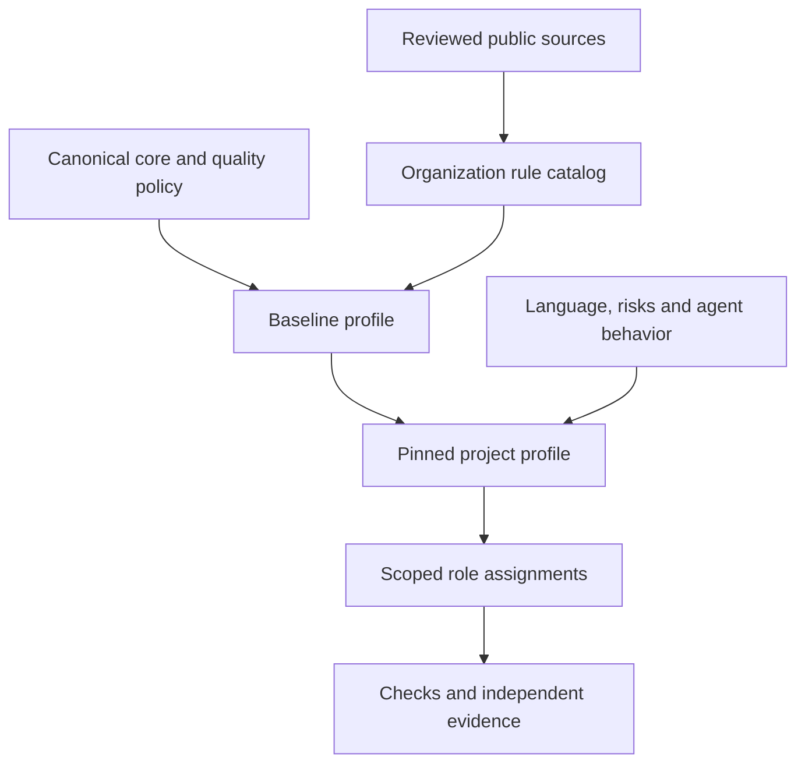
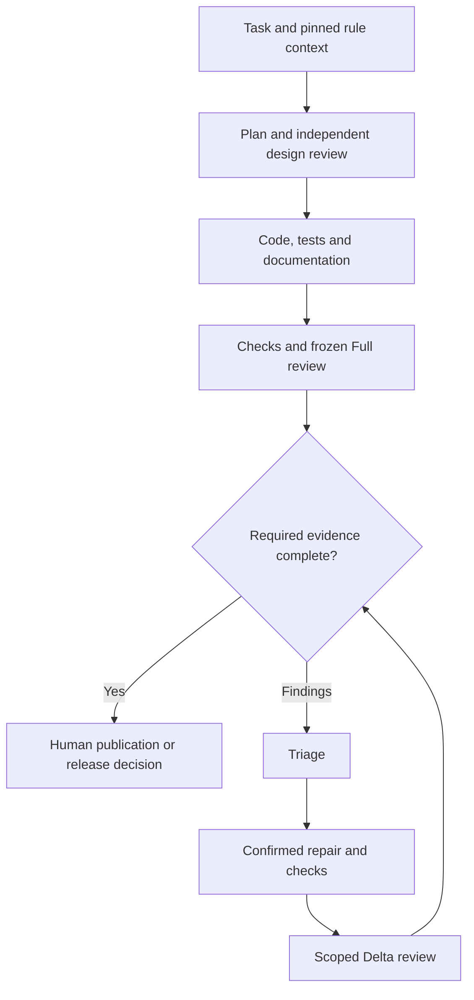

# Agentic quality framework

The quality framework makes project quality obligations explicit across planning,
architecture, code, tests, documentation and review. It extends the existing core
policy, Task Packets and workflow kit. Catalog version `1.0.0` contains 16
organization-owned rules; each rule is version `1`. The additive technology
extension supplies bounded language, platform, runtime and framework profiles under
the same policy authority; its version is tracked separately.

## Documents and ownership

| Source location | Purpose | Owner and use |
|---|---|---|
| `policy/quality.md` | Common quality obligations and evidence boundaries | Project owner selects applicability; every role follows the active contract |
| `standards/sources.json` | Official source editions, URLs, access and adoption limits | Source maintainers review provenance before catalog updates |
| `standards/rules.json` | Stable rule IDs, responsibilities, phases, evidence and check groups | Planner selects; implementer applies; reviewer checks |
| `standards/profiles/*.json` | Baseline and bounded refinements | Project owner selects during adoption; reviewer evaluates suitability |
| `standards/technologies/` | Versioned technology sources, mandatory rules, defaults and free choices | Source maintainers review; components select only applicable profiles |
| `.engineering-backbone/navigation.json` | Project document routes, component technology selections and additional check bindings | Project owner reviews; agents resolve and verify scoped context |
| `.engineering-backbone/quality-profile.json` | Project-owned reviewed commit, selection, document paths and bindings | Project owner maintains through reviewed PRs |
| `docs/quality/quality-plan.md` | Project goals, risks, responsibilities and release criteria | Planner establishes before work; reviewers assess changes |
| `docs/quality/test-strategy.md` | Test selection, coverage, data, environments and limitations | Planner and test implementer maintain; quality checker records execution |
| `docs/quality/traceability.csv` | Rule to requirement/risk, design, test/check and evidence mapping | Implementer updates; independent reviewer evaluates adequacy |
| `docs/quality/exceptions.md` | Declared bounded exceptions and compensating measures | Project human owner approves; review verifies authority and expiry |
| Existing requirements, architecture and `docs/reviews/` | Authoritative decisions and frozen-snapshot review evidence | Existing project owners and independent reviewers |

Document paths above are defaults. The profile may point to other safe
repository-relative locations. Exception documentation is required when exceptions
exist. Installed catalogs are managed beneath `.engineering-backbone/standards/`;
the installed policy and guide are `.engineering-backbone/quality-policy.md` and
`.engineering-backbone/quality-guide.md`. This guide uses plain repository paths so
it also remains valid when distributed to a consumer.

## Profiles and automatic bindings

Profiles combine by union; active selection always contains `baseline`. Refinements
add obligations. They cannot subtract baseline duties or stricter project policy.

| Profile | Applicability | Additional required PR kinds |
|---|---|---|
| `baseline` | Every active project, including documentation-only projects | At least one `test` or `docs` binding for the baseline test rule |
| `software` | Executable software; includes bounded security responsibilities | `build`, `lint`, `test`, `sast` |
| `python` | Python components | `lint`, `test`; workflow profile `python` |
| `typescript` | TypeScript components | `lint`, `typecheck`, `test`; workflow profile `typescript` |
| `high-risk` | Control-plane and other high-risk work | `test`, plus independent design/behavior/security evidence |
| `agentic` | Systems with agent dispatch, review, gates and returns | `test`, plus complete supported chain behavior |
| `cpp17` | Reference-only integration placeholder | Disabled: compatible guide subset and compiler integration pending |
| `iec61508` | Reference-only functional-safety placeholder | Disabled: full-text applicability and lifecycle obligations pending |
| `iec62304` | Reference-only medical-device placeholder | Disabled: full-text applicability and lifecycle obligations pending |

Every `check_kind_groups` entry is an any-of group; **all groups must be satisfied**.
For example `[["build"], ["lint"], ["test"], ["sast"]]` needs four kinds, while
`[["test", "docs"]]` needs at least one of those two kinds. A binding resolves an
actual PR check ID in the active complete workflow kit; a name in a document is
insufficient. A kind is a declared check category: independent review must still
assess whether its command and coverage establish the claimed result.

The profile uses the reviewed full commit SHA and catalog version; the selected
catalog fixes the resolved rule versions. Catalog sources are references;
candidates do not redefine authority.
Version 1 supports the compiler-owned current catalog only, rather than accepting
an arbitrary coherent base catalog. A future historical catalog allowlist requires
explicit trusted-source review.

## Technology profiles and navigation

Use `docs/quality/technology-profiles.md` and `docs/agent-navigation.md` in the source,
or `.engineering-backbone/technology-guide.md` and
`.engineering-backbone/navigation-guide.md` when installed. Navigation selects
technology profiles by explicit component paths. All matching components combine;
Task Packet exclusions still win. It adds required documents, exact profile/rule
identities and check bindings to the inherited quality context.

The extension covers common languages, PowerShell, Bash, PostgreSQL, data/config
formats, Windows/Linux, containers, runtimes and selected frontend/backend
frameworks. Presence in the catalog does not activate a profile or execute a tool.
Keep C and C++ separate, Node as a runtime and language/framework profiles distinct.
Select required base quality profiles as declared by each technology profile.
The general `cpp` extension does not enable the disabled `cpp17` reference above.

Mandatory `TECH-*` rules add obligations. Profile recommendations permit a recorded
technical rationale; `free_choices` leave ordinary implementation choices within
scope. The approved guard checks selected check-kind bindings, while project tests
and independent review assess actual behavior. A resolved receipt carries exact
document hashes and versions; its receiver verifies the complete context and reads
the documents. This proves neither native client discovery nor semantic compliance.

Navigation has its own reviewed inactive-seed and separate enabled-only activation
sequence, after quality and workflows are active. Existing native instructions and
project routing remain protected on update and require reviewed manual integration.

## Role obligations and phases

| Rule | Existing roles / bounded responsibility | Required result and timing |
|---|---|---|
| `QUAL-REQ-001` | Planner; independent reviewer | Identified requirements, risks, quality targets and acceptance before non-trivial work |
| `QUAL-DES-001` | Planner as architecture/security owner; reviewer | Affected design, interfaces, decisions and assumptions before a material change |
| `QUAL-CODE-001` | Implementer; quality checker; reviewer | Applicable code/security rules, checks and semantic review during implementation/verification |
| `QUAL-TEST-001` | Planner; test implementer; quality checker; reviewer | Risk-based strategy, coverage and genuine results from planning through verification |
| `QUAL-DOC-001` | Documentation implementer; reviewer | Changed documentation or justified no-impact decision before review completion |
| `QUAL-EVID-001` | Quality checker; reviewer | Actual revision-bound results, limitations and acceptance coverage before a PASS/closeout claim |
| `QUAL-REVIEW-001` | Reviewer; triage; repair implementer | Frozen Full, triage, confirmed repairs and scoped Deltas before publication |
| `QUAL-HANDOFF-001` | Planner as orchestration owner; every receiving role | Complete versioned task context and return/stop contract at each delegation |

Responsibilities do not add native roles, models, tools or runtime permissions.
Provider files and skills route to this same contract. Each handoff includes task
ID, profile/catalog/rule versions, relevant requirement/design context, acceptance
IDs, allowed paths/actions, required checks/evidence and stop/return conditions.
The recipient reports missing context instead of assuming inheritance. Verify
client discovery and capabilities separately from file/schema validity.

Human publication/release decisions remain subject to existing project gates. A
schema-valid profile or an AI review does not authenticate signatures, alter
repository protection or grant permission to merge/deploy.

## Adoption and updates

1. Opt into Copier's quality package during a reviewed installation. It creates
   an explicitly inactive, incomplete profile and project document skeletons.
   Legacy consumers without a quality profile remain supported.
2. Select the reviewed commit, profiles and exact rule versions. Fill project
   goals, strategy and traceability; configure complete active workflow checks and
   bind their actual PR IDs. Review suitability, local compatibility and any gaps.
3. Merge that complete **inactive** seed through the existing approval process.
   In a separate activation PR, change `enabled` only. Activation cannot invent a
   trusted base or silently replace previously reviewed contents.
4. Verify actual execution and independent evidence on the project, including a
   deliberately invalid required input/check. Configure the required repository
   checks and human controls separately. Consumer adoption is a separate delivery.

Ordinary updates preserve project-owned documents/profile and local native
instructions. Managed catalog refresh and preserved instruction fragments need
reviewed manual integration with the matching workflow pin. An active inherited
profile/selection/binding cannot simply disappear or weaken in a candidate. New
standards, rules and historical catalog support use a scoped reviewed source PR.

## Evidence and source limits

Structural validation checks bounded data, managed catalog identity, declared
selection, required files, rule mappings and check bindings. It executes no project
commands and does not assess document substance, design correctness, authentic
human approval, provider loading or software behavior. Those belong to the actual
workflow results and independent semantic reviews.

Traceability columns are exactly
`rule_id,requirement_id,risk,architecture,tests,check_ids,evidence,status`.
Each applicable rule needs a mapping. Refer to existing requirement, architecture,
test and evidence identities rather than reproducing them. A matrix entry remains
a declaration until its evidence is independently checked on the relevant stand.

The contract permits statuses `pending`, `planned`, `verified` and `gap`. Multiple
`check_ids` and `evidence` paths use semicolons without empty or duplicate entries.
Evidence entries are safe repository-relative regular-file paths; a `verified`
declaration needs a nonempty evidence file. Complete rows contain nonempty
requirement, risk, architecture and test mappings, and include all of their rule's
declared check bindings. A manual rule may have no check binding; documented
no-impact or nonapplicability decisions reference their reviewed rationale.
`verified` does not authenticate the file contents or prove runtime PASS. `pending`,
`planned` and `gap` remain visible declarations, not completed acceptance gates.

Profile exceptions have exactly `rule_id`, `scope`, `reason`, `owner`,
`approved_by`, `expires_on`, `compensating_check_ids` and `evidence_path`.
Expiration is an ISO date. Reference an actual regular evidence file and actual
PR compensating check IDs; baseline rules are nonwaivable. Review scope and human
authority independently. Once active, a candidate cannot introduce or change an
approved exception; profile migration requires a separately scoped reviewed
contract change instead of bypassing the inherited guard.

See the source register for exact editions and official URLs. ISO/IEEE/IEC entries
are **public-scope references**, not adopted clauses; the public abstracts are not
used to assert a formal conformance checklist. Microsoft practices inform bounded
organization choices. Google guidance currently targets C++20, so a C++17 subset
needs separate compatibility work. Living client/guide observations are dated
2026-10-13; the catalog versions our selected obligations, not an upstream website
snapshot. No external certification is supplied by this framework.
