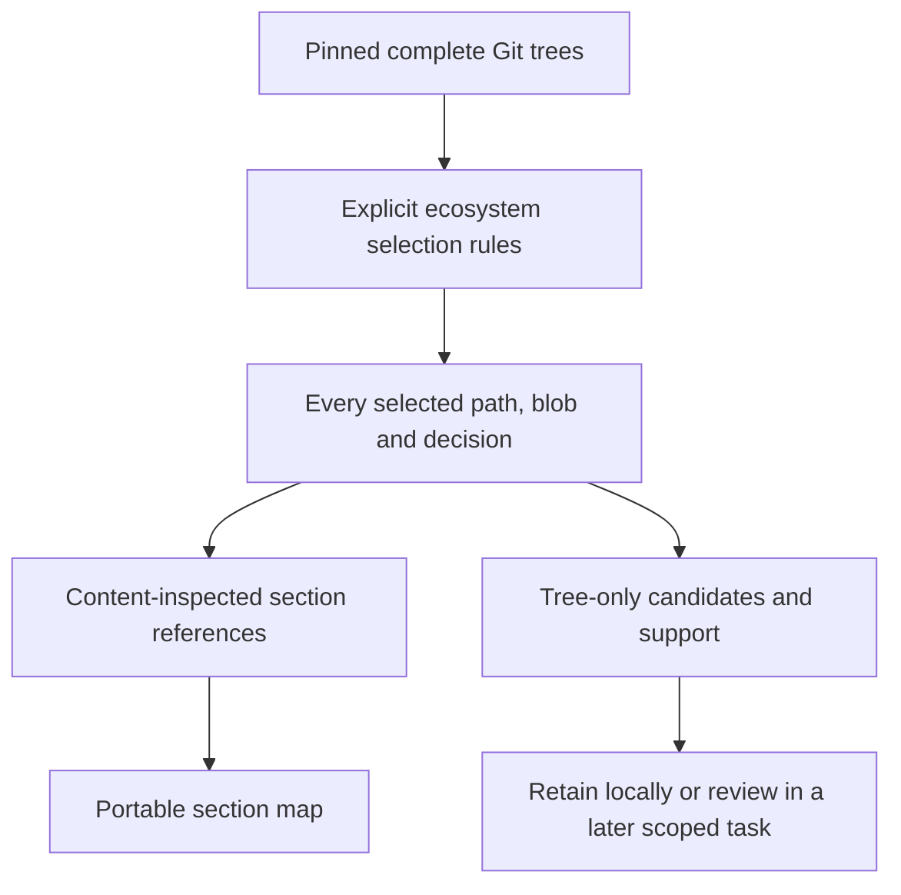

# Complete bounded Codex ecosystem inventories

Captured 2026-10-12 from complete recursive Git trees (`truncated=false`).
The source repositories were read-only. "Complete" means every blob selected by
that inventory's explicit `selection_rules` / `selection_rule`; it does not mean
all application files or all source behavior has been audited.

| Source | Inspected branch | Immutable commit | Selected files | Full contents inspected | Excerpts | Tree-only |
| --- | --- | --- | ---: | ---: | ---: | ---: |
| Tars | `feature/frontend` | `6dc0ee4ef712f6f1b26a11f180c36d6434a759c1` | 501 | 160 | 4 | 337 |
| Artifaktory | `staging` | `7ed20cd7853d7e19eb55e37f31fa6c6214952b1d` | 418 | 120 | 5 | 293 |

Artifaktory is compared with main `0307348366e900605b66f442e2075901e979ddb1`.
Its selected main files are unchanged on staging; staging adds 13 runner-support
paths. Tars uses its actual governance branch instead of default master.

## Every selected file and its decision

- [Tars per-file inventory](tars.json) and [extraction notes](tars-notes.md).
- [Artifaktory per-file inventory](artifaktory.json) and [extraction notes](artifaktory-notes.md).
- [Actual integrated sections and future adoption](../codex-consolidation.md).

Each entry records source path, immutable commit/blob, source URL, classification,
rationale, proposed destination and inspection coverage. Proposed destinations are
section-level crosswalks, not promises that entire source files or controllers were
ported. The section map above is the authoritative description of this PR's changes.
Tree-only entries have no semantic extraction guarantee.

| Classification | Tars | Artifaktory | Meaning |
| --- | ---: | ---: | --- |
| `integrate-common` | 137 | 85 | Reusable reference-section candidate; actual integration is limited to the named section map |
| `retain-local` | 137 | 112 | Branch/domain/host/runtime/permission rules and project support remain local |
| `defer-implementation` | 100 | 95 | A runtime or detailed contract port needs a separate reviewed implementation |
| `support-test` | 127 | 126 | Source tests, fixtures and historical reports; not Backbone test evidence |

Both selections include root/nested agent instructions, all Codex files and skills,
Copilot adapters, governance docs/schemas/scripts/tests and referenced engineering /
quality support. Directory rules are expanded to all contained blobs. Root package
metadata and application documents outside those recorded rules are not part of
the completeness claim. No source tests/controllers were executed by inventorying.

## Source conflicts and limits

Tars's conformance prose says Multi-Agent is enabled while its configuration
explicitly disables it. Its implicit-skill prose also differs from the 18 inspected
skill metadata files, which disable implicit invocation. Both contradictions are
recorded with pinned source blobs in its inventory/notes; the actual configured
capability is used and no source remediation is silently performed here.

Artifaktory's legacy `ai-agents/` prompts are non-authoritative by their README.
Disabled hooks/network/internal agents and broad source command allowlists are
not portable enforcement. See both extraction notes before adapting host settings.

