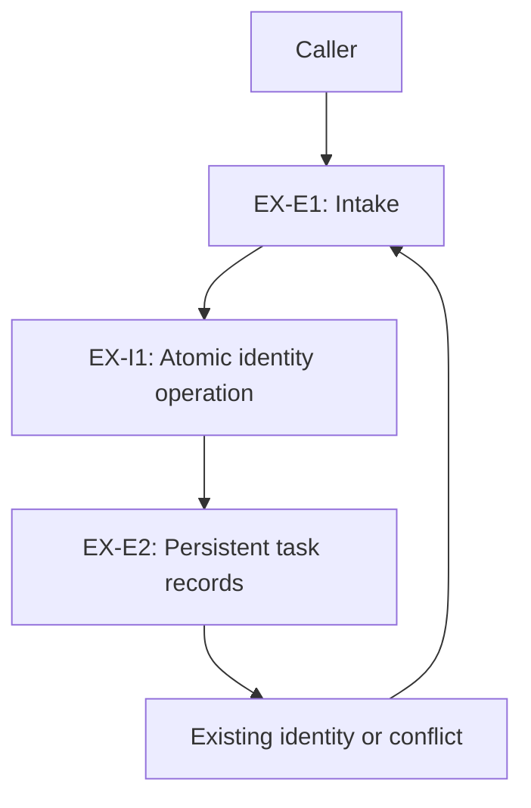

# Worked example: duplicate local task submission

**Fictional teaching example only.** This is not an Artifaktory, TARS, Mastra or
agent-factory specification. Every requirement and decision below is a draft;
there is no approved product baseline, implementation, executed test or PASS.
The example applies the [architecture contract](../../agent-governance/architecture.md)
without choosing a language, framework, database or modeling tool.

## 1. Establish the inputs

The example's sole source is this document, identified as `EX-SOURCE-v1`. A real
project would substitute an immutable source revision and named decision owners.
"Task" means a persisted submission record, not execution of an external side effect.
The example does not claim exactly-once execution of a task's work.

| Draft ID | Fictional statement / criterion | Origin and decision owner |
| --- | --- | --- |
| `EX-REQ-1` | Repeating a submission with the same task ID and payload must not create a second local task record; callers receive the same task identity. | Hypothetical requester statement in `EX-SOURCE-v1`; project requirement owner remains unassigned |
| `EX-REQ-2` | A different payload presented under an existing task ID must produce an explicit conflict and must not replace the existing task. | Proposed derived requirement from the ambiguity in `EX-REQ-1`; approval pending with the requirement owner |
| `EX-REQ-3` | The handover guide explains how an operator recognizes a duplicate or conflicting submission. | Hypothetical documentation requirement in `EX-SOURCE-v1`; documentation owner remains unassigned |

`EX-OPEN-1`: How long must a task ID remain reserved, including after task cleanup?
The requirement owner must decide retention semantics. The phrase "must not create
a second record" cannot silently become a permanent-retention or time-window rule.
Draft design exploration can continue; binding approval of that behavior cannot.

## 2. Derive scenarios and drivers

`EX-REQ-1` makes identity and concurrent intake significant design concerns.
`EX-REQ-2` adds a proposed conflict behavior. No performance threshold is invented.

| Scenario | Stimulus and context | Proposed observable response / measure | Source and status |
| --- | --- | --- | --- |
| `EX-QS-1` | Two callers concurrently submit an identical ID and payload while the local store is available. | Exactly one persisted task record; both responses identify that record. | Refines draft `EX-REQ-1`; proposed |
| `EX-QS-2` | After restart, a caller repeats an identical ID/payload whose task record is still retained. | No additional task record; the existing identity is returned. | Refines draft `EX-REQ-1` under the explicit retained-record precondition; proposed |
| `EX-QS-3` | A caller submits a different payload under a retained ID. | An explicit conflict; zero modifications to the original task record. | Refines proposed `EX-REQ-2`; proposed |

The measures "one record" and "zero modifications" follow the fictional statements.
The retention duration remains open; tests cannot decide it on behalf of the owner.

## 3. Compare and propose a decision

`EX-ADR-1`, **proposed**, compares these options against the scenarios:

| Option | Benefit | Limitation / uncertainty |
| --- | --- | --- |
| A process-local mutex and in-memory ID set | Small local mechanism for one running process | Does not by itself retain identity after restart or coordinate separate processes |
| Persistent uniqueness with atomic create-or-read and payload comparison | Could coordinate intake and retain identity while the record exists | Depends on actual storage semantics, transaction boundaries and conflict handling |
| Caller-side duplicate prevention only | Simple server intake | Does not cover two independent callers or retried requests after lost responses |

The proposed choice is persistent atomic identity handling because it plausibly
addresses concurrency and restart. Its suitability is **not established**: the
actual storage API and failure behavior need investigation. Retention cleanup and
the proposed conflict rule require owner decisions before the scoped implementation
gate can pass. A prototype may reduce uncertainty without establishing production
acceptance. Revisit the choice if multi-site intake or new retention requirements
change the consistency boundary.

## 4. Describe the design claim

The target view serves implementers and reviewers asking who owns duplicate handling.
Boxes identify responsibilities, arrows identify calls, and the source state is the
draft `EX-SOURCE-v1`. This is a conceptual view, not a deployed-system diagram.

`EX-E1` validates the submission and invokes `EX-I1`. `EX-E2` owns task identity
and payload identity data; the actual schema is undecided. The runtime view must
specify create, duplicate, conflict and storage-error outcomes. In the proposed
failure path, intake must not claim successful persistence after a failed storage
operation. A lost response followed by retry must go through the same identity
operation. These are design claims to assess, not implemented behavior.

The deployment assumption is one logical authoritative local store. No process
count, database product, web UI or container platform is selected. Introducing a
second independent writer/store would invalidate that assumption and require an
impact assessment. A component ID here does not prescribe a repository directory.

## 5. Account for every requirement and plan verification

| Requirement | Architecture disposition | Linked design | Planned fulfillment / verification |
| --- | --- | --- | --- |
| `EX-REQ-1` | Draft target design exists; required retention semantics remain open | `EX-QS-1`, `EX-QS-2`, `EX-ADR-1`, `EX-E1`, `EX-E2`, `EX-I1` | `EX-CHECK-1` concurrent duplicate submission; `EX-CHECK-2` restart/retry of retained ID; retained-record lifetime still unresolved |
| `EX-REQ-2` | Proposed derived requirement; decision owner needed | `EX-QS-3`, `EX-ADR-1`, `EX-I1` | `EX-CHECK-3` conflicting payload rejects without modifying the stored task |
| `EX-REQ-3` | No additional structural impact: describes the selected intake outcomes | Existing target runtime outcomes from `EX-I1`; no separate ADR needed | `EX-CHECK-4` manual review of operator guidance against the actual accepted behavior |

One decision addresses two requirements; one requirement uses multiple scenarios
and checks. The guide has a justified non-structural fulfillment route, not a missing
row. Each check still needs an assigned owner, actual environment, procedure and
evidence location in the consuming project.

All four checks are **planned / not run**. No code reference or result artifact
exists. An eventual report would identify the exact implementation revision,
environment, inputs, expected/actual observations and limits. A row in this table
cannot be recorded as verified evidence.

## 6. Review and gate conclusion

An independent reviewer can inspect the draft's reasoning and identify open items.
There is no actual reviewer or review result in this example. The following is the
expected treatment of its visible gaps, not a completed review:

| Claim | Current example state |
| --- | --- |
| Source requirements approved | No; all fictional statements are drafts |
| Ready for exploratory design discussion | Inputs and open questions are visible |
| Scoped behavior ready for implementation | Blocked: requirement/decision authorities, retention semantics and storage assumptions are unresolved |
| Design implemented | Not established |
| Behavior verified | Not run; no evidence |

An agent must return these open items to the appropriate owner, not invent a
retention window, select a product stack or manufacture approval to complete the form.

## 7. Follow a requirement change in both directions

Suppose a future `EX-SOURCE-v2` explicitly permits ID reuse after an approved
retention period. That hypothetical change would affect `EX-REQ-1`, `EX-OPEN-1`,
cleanup behavior, `EX-ADR-1`, `EX-E2`, the runtime view and the bounds of
`EX-QS-2` / `EX-CHECK-2`. Reassess cleanup/retry races and update the guide governed
by `EX-REQ-3`. Historical results for v1 would retain their v1 identity; they would
not automatically verify the changed lifetime rule.

Reverse inspection from `EX-E2` finds its requirement and decision basis; forward
inspection from `EX-REQ-1` finds the affected design and planned checks. Equivalent
links in a requirements tool and model viewer would serve the same purpose, provided
their IDs, source versions, meaning and open states remain inspectable.
