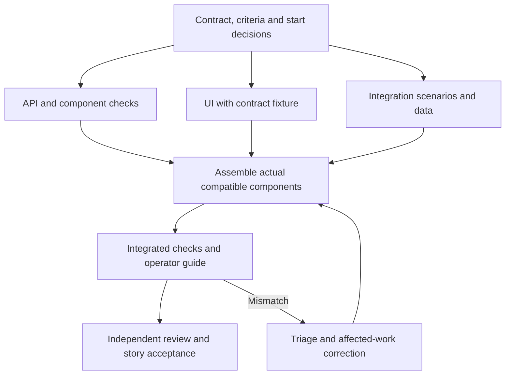

# Worked example: submit a request and inspect its status

**Fictional teaching example only.** This is not an Artifaktory, Tars, Mastra or
Agent Factory specification. All sources and decisions below are drafts; no person
has approved them, no implementation exists and no test has run. The example shows
how the [planning contract](../../agent-governance/planning.md) could be applied
without selecting a language, UI framework, database, tracker or agent host.

## 1. Carry the goal, requirements and architecture into planning

`EX-P-SOURCE-v1` means this illustrative source snapshot, not a real Git commit.
A real project substitutes immutable source identities and named owners. The goal
`EX-P-GOAL-1` is that a user can submit a local processing request and understand its
recorded state without exposing another user's request. External task execution,
payments and other real-world side effects are excluded.

| Draft input | Statement / design claim | Decision owner and state |
| --- | --- | --- |
| `EX-P-REQ-1` | A valid submission produces a stable request identity and an observable initial state. | Product owner, unassigned; draft |
| `EX-P-REQ-2` | The requester can read the request's state; an unrelated user cannot read its details. | Product/security decision owners, unassigned; draft |
| `EX-P-REQ-3` | Retrying the same client request key and payload while that key is retained returns the same request identity. | Product owner, unassigned; draft |
| `EX-P-REQ-4` | Operator guidance explains accepted, rejected, duplicate and unavailable outcomes without disclosing sensitive request content. | Documentation/product owners, unassigned; draft |
| `EX-P-ADR-1` | A request service owns identity and state; the UI consumes its contract. Persistent identity operations must preserve retry invariants. | Architecture owner, unassigned; proposed |
| `EX-P-I1-v1` | Proposed submission/status interface covers payload, identity, states, errors, retry key and access rules. | Interface owner, unassigned; draft |

The planning input is this requirement/design handoff. It does not approve the
architecture or derive a new product requirement merely by adding a work item.
`EX-P-OPEN-1`: the retention duration and permitted reuse of request keys are unknown.
The product and architecture owners must resolve the effect on `EX-P-REQ-3` and
`EX-P-I1-v1`. Authorization integration also needs a real supported identity contract.

## 2. Propose the delivery plan

`EX-P-PLAN-1`, draft, chooses feature depth because one user outcome needs several
technical contributions and integration. The first delivery is a thin usable flow:
submit, receive identity, read authorized status, explain relevant failures. Later
bulk submission and richer progress display are excluded from this delivery.

| Work package | Proposed outcome | Delivery items |
| --- | --- | --- |
| `EX-P-WP-1` Contract clarification | Resolve retry/access assumptions and review interface plus acceptance examples | `EX-P-DI-CONTRACT` investigation/contract definition |
| `EX-P-WP-2` Request/status feature | Implement and assemble the user outcome | `EX-P-STORY-1`, with API, UI, verification preparation and integration assignments below |

`EX-P-STORY-1`: "As a requester, I can submit a request and inspect its state so I
know whether it was recorded and how it is progressing." Its requirements remain
`EX-P-REQ-1..4`; the technical assignments support this one user-valued result.
Each is assessable, but API and UI are not falsely presented as two independently
usable user stories. A work package is not automatically a tracker Issue.

## 3. Define bounded assignments and typed prerequisites

| Item / type | Proposed result and write scope | Required input / start condition | Responsibility |
| --- | --- | --- | --- |
| `EX-P-DI-CONTRACT` investigation | Decision record, interface definition and acceptance examples; no product-code writes | Authorized bounded investigation; actual time/budget and owner must be assigned | Product/architecture responsibility |
| `EX-P-DI-API` technical contribution | Request/status service and component tests; owns backend implementation, not shared interface changes | **Contract**: accepted `EX-P-I1` revision plus resolved retry/access decisions | Backend implementation responsibility |
| `EX-P-DI-UI` technical contribution | Submission/status UI and component tests; owns UI, uses a contract-compatible fixture | **Contract**: same accepted `EX-P-I1` revision; no API implementation prerequisite for fixture-based work | UI implementation responsibility |
| `EX-P-DI-CHECKS` verification preparation | Independent contract/integration scenarios and safe test data; owns test preparation | **Contract**: same accepted interface and acceptance criteria | Test implementation responsibility; not its own final reviewer |
| `EX-P-DI-INTEGRATE` integration | Compatible assembled result, operator guidance and executed required checks | **Implementation**: API/UI/check assets available; **integrated result**: resulting target revision exercised before story acceptance | Named integration owner required |

These are illustrative responsibility labels, not assigned people or agents.
Concrete paths and immutable execution revisions are still absent. Consequently
none of these rows is an executable Task Packet and implementation is currently
blocked. An authorized investigation may proceed only within its own assigned scope.

After the required decisions and independent plan/decomposition review, the proposed
schedule has this shape:

The diagram represents dependency conditions, not evidence that an approval or run
occurred. Implementation and review capacity must be assigned before all three
parallel branches are started.

## 4. Make shared conflicts and integration explicit

`EX-P-CONFLICT-1` covers the interface definition and shared generated types. API
and UI workers may read the accepted version; changes return to the interface owner
and affected work is reassessed. Separate files do not remove this semantic conflict.

`EX-P-CONFLICT-2` covers the integration environment and test data. Component checks
can use isolated fixtures; assembled checks need controlled data and an available
environment. The integration owner allocates that resource and records the tested
component revisions. No production data or credentials are assumed available.

The proposed integration order is compatible API/UI/test assets, assembled checks,
operator-guide check, independent implementation review and acceptance. Local project
rules may permit safe intermediate merges, but no merged component alone completes
the story. Any relevant data migration/recovery plan must be added once actual
storage is selected; its absence is an unresolved planning input, not an exemption.

## 5. Account for acceptance and planned evidence

| Criterion / source | Observable expectation | Assigned work / planned verification | Current evidence |
| --- | --- | --- | --- |
| `EX-P-AC-1` / `EX-P-REQ-1` | Valid submission returns an identity; an authorized subsequent read observes the corresponding initial state | API + UI + integration; real assembled request/read scenario | Not run |
| `EX-P-AC-2` / `EX-P-REQ-2` | The requester can read status; an unrelated user cannot obtain the request details | API access tests and assembled positive/negative authorization scenarios | Not run; real identity contract unresolved |
| `EX-P-AC-3` / `EX-P-REQ-3` | Identical key/payload retries within the accepted retention condition retain one identity | Contract investigation, API concurrency/retry tests and assembled retry scenario | Blocked by `EX-P-OPEN-1`; no result |
| `EX-P-AC-4` / `EX-P-REQ-4` | Guidance agrees with accepted outcomes and contains no sensitive example data | Integration/documentation work; manual comparison against actual behavior | Not assessed |

This coverage includes every scoped requirement and gives each technical assignment
a purpose. One requirement uses several items/checks; an integration item covers
several requirements. Real records must add procedures, owners, environments,
source/implementation revisions, expected versus observed results and evidence paths.

Component mocks would establish only their isolated contract assumptions. They
cannot verify the real identity service, persistence, permissions or combined user
flow. Product-specific performance, accessibility and operating constraints still
need an applicability decision; this example invents no universal threshold.

## 6. Bind real work only when it is ready

A future tracker Issue would point to the accepted item ID and definition revision.
Its execution Task Packet would bind that source, actual repository base, permitted
paths/actions, responsibility, criteria, checks, budget and stop/return conditions.
Unknown identity integration, an unresolved required decision or unavailable
permissions would remain explicit blockers. A repeated run would use a distinct
packet and evidence identity. No extra Task Packet JSON fields are required.

The current gate record is: plan draft; decomposition proposed; start prerequisites
unresolved; implementation absent; checks not run; acceptance not assessed; release
not authorized. Task Packet `ready_for_review` would describe a later frozen review
subject, not override any of these conditions.

## 7. Follow a contract change through affected work

Suppose a future decision permits key reuse after a defined retention window,
producing `EX-P-I1-v2`. This is hypothetical, not an approved change. The owner must
reassess `EX-P-REQ-3`, `EX-P-ADR-1`, cleanup/retry races, API behavior, UI retry/error
handling, test fixtures and `EX-P-AC-3`. The operator guide may also change.

Pause or narrow affected assignments, review the changed plan/contract scope,
replace stale packet bindings and update the derived tracker view. Determine which
unaffected work can continue; do not restart everything by default. Previous v1
results, if they later exist, retain their v1 identity. Integrate compatible v2
components and execute the required v2 checks before claiming v2 acceptance.
